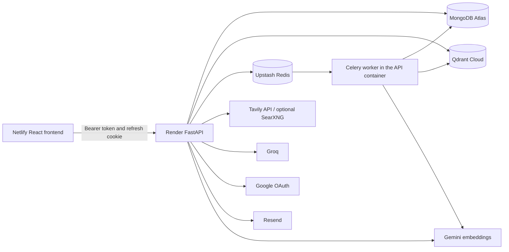
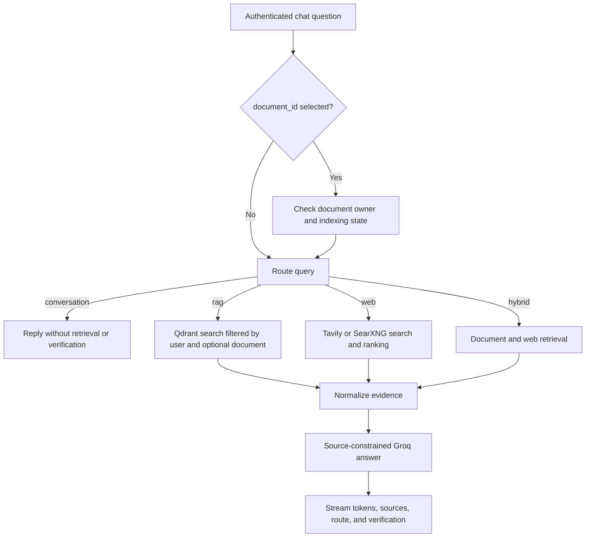

# AskLaw

AskLaw is a legal research and document workspace with a public demo. Users can research their own uploaded PDFs, search web sources, inspect streamed answers and source support, review or compare agreements with **Before You Sign**, and prepare a reviewed timeline, evidence index and complaint-letter draft with **Consumer Complaint Pack**.

The application uses React, FastAPI, MongoDB, Qdrant and Celery, with Gemini embeddings, Groq generation and Tavily web search. The maintainer has confirmed the Complaint Pack and its in-page confirmation fix working after deployment. See [current status](#current-status) for the distinction between automated checks, live confirmation and Git branch promotion.

AskLaw provides educational and informational research assistance, not legal advice. Retrieved sources and the claim verifier help users inspect an answer; they do not establish that an answer is legally correct.

## Contents

- [Live demo and deployment](#live-demo-and-deployment)
- [Current status](#current-status)
- [What AskLaw does](#what-asklaw-does)
- [Architecture](#architecture)
- [Research pipeline](#research-pipeline)
- [Document lifecycle](#document-lifecycle)
- [Technology stack](#technology-stack)
- [Project structure](#project-structure)
- [Local setup](#local-setup)
- [Environment variables](#environment-variables)
- [API overview](#api-overview)
- [Document-scoped research](#document-scoped-research)
- [Verification](#verification)
- [Before You Sign](#before-you-sign)
- [Consumer Complaint Pack](#consumer-complaint-pack)
- [Testing and evaluation](#testing-and-evaluation)
- [Measured metrics and résumé claims](#measured-metrics-and-résumé-claims)
- [Security and limitations](#security-and-limitations)
- [Deployment notes](#deployment-notes)

## Live demo and deployment

| Part | Current deployment | Role |
| --- | --- | --- |
| Frontend | [askklaw.netlify.app](https://askklaw.netlify.app/) on Netlify | Vite-built React single-page application; `frontend/public/_redirects` supports direct route loads |
| API and indexing worker | [asklaw-api.onrender.com](https://asklaw-api.onrender.com/health) on one Render Free Web Service | FastAPI and one Celery worker run in the same backend container |
| Web search | Tavily API | Active hosted search provider; avoids depending on the separate SearXNG service waking up |
| Accounts, documents, conversations | MongoDB Atlas | Persistent MongoDB records |
| Document vectors | Qdrant Cloud | The Gemini collection is `asklaw_documents_gemini` |
| Task queue and results | Upstash Redis | TLS `rediss://` connections for Celery's broker and result backend |
| Embeddings | Gemini Embedding 2 | Batched, 3072-dimensional document and query embeddings |
| Answer generation | Groq | Streamed chat completions |
| Authentication email | Resend | Email verification and password-reset codes |
| Google sign-in | Google OAuth | Verified Google identity, linked to an AskLaw account |

The Netlify frontend and Render API URLs above are the project's existing public demo. Deployments have used both `deployment` and `codex/guest-demo-experience`; the live commit and configured branch must be checked in each hosting dashboard, not inferred from a local checkout. Credentials belong in untracked environment files or hosting settings.

SearXNG remains an optional provider in the code and has a separate Render service at [asklaw-searxng.onrender.com](https://asklaw-searxng.onrender.com/healthz). It is not required by the Tavily search path. No new live endpoint check was performed for this documentation update.

## Current status

As of 20 October 2026:

- Research chat, email/Google/passkey authentication, guest entry, Tavily search and Before You Sign have previously been reported working in the public demo.
- Complaint Pack was developed on `codex/consumer-complaint-pack` and integrated into `codex/guest-demo-experience` as `aaaf010`. The maintainer subsequently confirmed deployment and the in-page confirmation fix (`56bc488`) working live. This is maintainer-reported acceptance, not a new independent production audit.
- The tested application was promoted in order: **`codex/guest-demo-experience` → `deployment` → `main`**. `deployment` was fast-forwarded to `56bc488`; `main` preserves its earlier documentation history through a merge, resolving the README against the current implementation. Git promotion does not change which branch Netlify or Render is configured to deploy.
- Latest regression checks pass: **307 backend tests, 41 frontend tests**, lint, production build and compile checks. The backend count includes 15 benchmark-accounting and four stream-diagnostic tests; desktop/mobile Complaint Pack workflows were also checked on 19 October. Small live measurements include both successes and failures; functional test success must not be confused with live reliability. See [measured metrics](#measured-metrics-and-résumé-claims).

This status records repository changes and user-confirmed deployment, not an automatic check that every production service is running the same commit. No credentials, environment files or hosting settings were changed during branch promotion. The discarded scenario/playbook experiment is not part of this release.

### Recent implementation milestones

| Area | What changed |
| --- | --- |
| Authentication and demo | Email verification/reset, Google sign-in and platform passkeys; temporary guest entry, short guest quota, example questions, legal-information disclaimer and API waking feedback |
| Reliability and safeguards | Cross-site production refresh cookies, shared Redis quotas, verified proxy-hop parsing, bounded Gemini calls, processing leases/recovery, failed-vector cleanup, ready-document filtering and actionable enqueue failures |
| Web research | Bounded readiness/progress for optional SearXNG, retrieval deadlines, structured outage notices and HYBRID degradation; active search moved to Tavily (`95c35dd`) after recurring SearXNG cold-start/outage problems |
| Before You Sign | Source-linked English agreement review and two-version comparison (`19b7c0d`), followed by focused clause candidates/local excerpts (`492fac9`) rather than repeated broad page excerpts |
| Complaint Pack | Owner-scoped saved cases, exact PDF references, deterministic checklist/letter/export, conservative two-PDF import, consent-gated Groq narrative intake and reviewed timeline matching (`aaaf010`) |
| Confirmation UX | Native replacement/discard/delete pop-ups replaced with in-page comparisons and Confirm/Cancel controls, including stale-state protection and desktop/mobile regression coverage (`56bc488`) |

## What AskLaw does

### Authentication and sessions

- Email/password signup sends a six-digit verification code through Resend. A pending account must verify its email before password sign-in.
- Forgot-password and reset-password use single-use, expiring email codes. A password reset increments the account's authentication version, invalidating older versioned tokens.
- Google OAuth verifies Google's ID token and links or creates a user using a verified email. The frontend receives an AskLaw session after exchanging a short-lived, one-time code.
- Signed-in users can register, list, and remove passkeys on the protected `/security` page. Registration requests a platform authenticator with a discoverable credential and user verification. Supported Mac and iPhone browsers can use Touch ID or Face ID; the browser and operating system control the biometric prompt.
- Password, Google, and passkey sign-in all issue the same AskLaw access token and HttpOnly refresh cookie. The access token is held in browser `localStorage`; the refresh cookie uses the `/auth` path, `SameSite=None` with `Secure` in production for Netlify → Render requests, and `SameSite=Lax` locally. Browser cookie restrictions can still affect cross-site sessions.
- The frontend restores protected sessions with `/auth/me` and performs one shared refresh attempt after an authenticated request receives `401`.
- Passkeys are bound to their WebAuthn relying-party domain. A passkey registered for `localhost` does not sign in to `askklaw.netlify.app`; users register a production passkey separately.

**Guest demo:** Five chat questions for one hour, with server-enforced expiry/quota and access to the synthetic agreement sample; private PDF tools and Complaint Pack require a registered account.

### Document workspace

- A persistent, newest-first library shows only the authenticated user's PDF records.
- Upload validates a PDF filename and MIME type, then extracts text and page-aware chunks in the API request. Celery embeds those chunks and indexes them in Qdrant in the background.
- The Documents page shows `uploaded`, `processing`, `indexed`, and `failed` states, polls while indexing is in progress, and offers Research when a document is ready.
- Users can delete an owned document after processing finishes. The backend removes its Qdrant points before removing its MongoDB record.

### Research chat

- Conversations and message history are stored in MongoDB and scoped to the authenticated user.
- The deterministic query router chooses conversational, document RAG, web, or hybrid research. A clearly casual greeting bypasses retrieval and has no sources or grounding score.
- A general question can use web search without an uploaded document. An unscoped RAG query with no document results falls back to web retrieval; a selected document remains scoped to that document.
- The chat streams answer tokens and then backend-created source, route, and verification metadata. Document sources and web sources are displayed separately, including hybrid answers.
- The frontend shows claim support (`supported`, `partial`, or `unsupported`) and a grounding score when research verification data is returned.
- A slow first API health check shows a server-waking message. Research has a configurable 75-second retrieval deadline; dependency outages produce structured availability notices rather than being presented as empty search results. HYBRID retains usable evidence if one retrieval branch fails.

## Architecture



The Render backend image runs `backend/docker/start.sh`: one Celery worker (`solo`, concurrency 1) and one Uvicorn worker bound to `0.0.0.0:$PORT`. This is the project's Render Free demo arrangement; there is no paid Background Worker service. If either child process exits, the script stops the other so Render can restart the container.

The web retrieval path calls AskLaw's `search_web` MCP tool function in the API process. `WEB_SEARCH_PROVIDER` selects Tavily or SearXNG. Tavily uses bounded basic-depth requests, no automatic POST retries, and a default maximum of two search queries per retrieval. SearXNG retains its bounded readiness checks and cold-start progress events. Local development also starts a standalone MCP server; the public backend startup does not start a separate MCP process. The `compose.production.yml` stack is an alternative deployment option, not the current Netlify/Render setup.

## Research pipeline



The router recognizes legal provision and document wording, current-event wording, general questions, and a narrow set of complete casual utterances. Web research can expand a recent legal question into targeted searches and rank the results within provider/request budgets. The backend creates source metadata from retrieved material rather than accepting generated citations as the source list. Empty results and a failed dependency are distinct outcomes. Availability notices are separate from evidence and claims, excluded from later model history, and persisted only with a server-verified availability receipt.

## Document lifecycle

1. `POST /documents/upload` receives a multipart `file` field from an authenticated user. It checks the PDF filename, `application/pdf` MIME type, upload size, page count, and extracted-text size.
2. `pypdf` extracts selectable text page by page. AskLaw stores the text, page-aware chunks, metadata, owner ID, and initial `uploaded` status in the existing MongoDB `documents` collection. It does not keep the original PDF binary.
3. The API submits an indexing task to Celery through Redis. The worker claims the record, sets `processing`, batches embeddings, and writes vectors with `user_id`, `document_id`, filename, page number, and chunk index in the Qdrant payload.
4. The worker marks the record `indexed` on success or `failed` after an unrecoverable error or exhausted retries, with a sanitized failure code. Processing claims have renewable 30-minute leases; stale processing is recovered to failed on library/retrieval access. Terminal failures remove partial vectors, with pending cleanup retried on library access. Enqueue failures are surfaced rather than leaving a silently accepted upload.
5. Research considers only owned, ready/indexed documents and preserves Qdrant owner/document filters. Deletion is blocked while a record is `uploaded` or `processing`. The Documents page polls pending uploads and shows failures.

Chunks are 1,000 characters with 150 characters of overlap. The local MiniLM option produces 384-dimensional vectors in its own collection. The Gemini option uses `gemini-embedding-2`, 3072 dimensions, a separate `asklaw_documents_gemini` collection, and a configurable batch size (default 32). AskLaw validates an existing collection's vector size rather than changing it. The Gemini Docker image omits PyTorch, Sentence Transformers, and the local model weights.

## Technology stack

| Layer | Implementation |
| --- | --- |
| Frontend | React 19, React Router 7, Vite 8, Axios, React Markdown, Tailwind CSS 4 |
| API | FastAPI, Pydantic, Uvicorn, Python 3.12 production image |
| Persistence | PyMongo and MongoDB Atlas in the public deployment |
| Vector search | Qdrant client and Qdrant Cloud in the public deployment |
| Embeddings | Gemini Embedding 2 in production; optional local MiniLM provider |
| Background work | Celery with Redis broker and result backend |
| Web search | Tavily API; optional SearXNG JSON API, behind the same AskLaw MCP tool function |
| Generation | Groq API |
| Authentication | bcrypt, JWT access/refresh tokens, Google OAuth, email OTP, WebAuthn passkeys |
| PDF extraction | `pypdf` |
| Hosting | Netlify frontend, Render API/Celery, external managed data services; separate optional SearXNG service |

## Project structure

```text
AskLaw/
├── backend/
│   ├── app/api/                 # Auth, documents, chat, agreements, complaints, health
│   ├── app/core/                # Settings, dependencies, Celery
│   ├── app/db/                  # MongoDB collections and indexes
│   ├── app/mcp/                 # Provider-selectable web search tool
│   ├── app/services/            # Auth, document, retrieval, generation, verification
│   ├── app/tasks/               # Background document indexing
│   ├── docker/start.sh          # Combined Render API/Celery startup
│   ├── evaluation/              # Offline and live evaluation harness
│   ├── tests/                   # Backend tests
│   ├── Dockerfile
│   └── requirements-gemini.txt  # Smaller Gemini production dependency set
├── frontend/
│   ├── public/_redirects        # Netlify SPA route fallback
│   ├── src/pages/               # Landing, auth, chat, documents, agreements, complaints
│   ├── src/components/          # Workspace, chat, and auth UI
│   ├── src/hooks/               # Streaming chat and conversation state
│   ├── src/services/            # API, auth, chat, passkey clients
│   ├── tests/                   # Frontend tests
│   └── vercel.json              # Alternative Vercel SPA rewrite
├── deploy/searxng/              # Separate Render SearXNG image and settings
├── COMPLAINTS.md                # Complaint Pack behavior, safety and acceptance notes
├── compose.production.yml       # Alternative self-hosted production stack
├── docker-compose.yml           # Local MongoDB, Qdrant, Redis, SearXNG
├── start.sh                      # Starts the local application stack
└── stop.sh                       # Stops the local application stack
```

## Local setup

You need Python, Node.js/npm, Docker Compose, and credentials for the features you want to exercise. The production Dockerfile uses Python 3.12; the frontend Dockerfile builds with Node 22. MongoDB, Qdrant, Redis, and SearXNG can run locally through the root Compose file.

```bash
git clone https://github.com/akhhilreddy/AskLaw.git
cd AskLaw/backend
python3 -m venv .venv
source .venv/bin/activate
python -m pip install -r requirements.txt
cp .env.example .env
cd ../frontend
npm ci
cp .env.example .env
cd ..
```

Before startup, edit `backend/.env`. Set a non-default `SECRET_KEY` and a `GROQ_API_KEY` for generated answers and optional complaint narrative intake. The checked-in backend example selects Gemini embeddings but leaves `GEMINI_API_KEY` empty; supply that key or switch to `EMBEDDING_PROVIDER=local` with a 384-dimensional local collection. To use Tavily, set `WEB_SEARCH_PROVIDER=tavily` and `TAVILY_API_KEY` in the backend only; neither belongs in frontend variables. Without this override the code default remains SearXNG. Email signup and password reset require `RESEND_API_KEY` and a verified `EMAIL_FROM` sender. Google sign-in requires its client ID, secret, and callback URI. Passkeys use the local frontend origin and RP ID derived from `FRONTEND_URL` unless explicitly overridden. Keep all credentials in untracked environment files or hosting settings.

The code defaults to 5 MiB / 50 PDF pages, but the existing `.env.example` explicitly overrides these to 20 MiB / 500 pages. Review those values when copying it; this README update does not change configuration. Agreement review and complaint source pages have an independent 50-page / 100,000-character limit and require readable text on every page.

Then start the local stack:

```bash
./start.sh
```

Open `http://localhost:5173`; the API docs are at `http://localhost:8000/docs`. The local script starts Docker services, FastAPI, Celery, a local MCP server, and Vite. Stop it with `Ctrl+C` or `./stop.sh`. The root Compose file uses named data volumes by default; optional `ASKLAW_MONGODB_DATA` and `ASKLAW_QDRANT_DATA` overrides retain existing bind-mounted data.

## Environment variables

The backend settings are defined in [`backend/app/core/config.py`](backend/app/core/config.py). The checked-in [`backend/.env.example`](backend/.env.example) is for local development; [`deploy/production.env.example`](deploy/production.env.example) is a secret-free example for the alternative Compose stack. The public Render service uses its own environment settings.

| Group | Backend variables | Purpose |
| --- | --- | --- |
| App and sessions | `APP_ENV`, `SECRET_KEY`, `ALGORITHM`, `ACCESS_TOKEN_EXPIRE_MINUTES`, `REFRESH_TOKEN_EXPIRE_DAYS`, `COOKIE_SECURE`, `ALLOW_LEGACY_UNTYPED_REFRESH_TOKENS` | JWT/session settings and production checks |
| Browser origins | `FRONTEND_URL`, `CORS_ORIGINS` | Frontend redirects and allowed credentialed requests |
| Trusted proxy | `TRUSTED_PROXY_HOPS` | Right-most-Nth forwarded client address; local default 0, measured Render value 3; see `deploy/rate-limits.md` |
| Email codes | `RESEND_API_KEY`, `EMAIL_FROM`, `EMAIL_OTP_SECRET`, `EMAIL_OTP_EXPIRE_MINUTES`, `EMAIL_OTP_MAX_ATTEMPTS`, `EMAIL_OTP_RESEND_COOLDOWN_SECONDS` | Verification and password reset |
| Google OAuth | `GOOGLE_CLIENT_ID`, `GOOGLE_CLIENT_SECRET`, `GOOGLE_REDIRECT_URI`, `GOOGLE_OAUTH_STATE_EXPIRE_MINUTES`, `GOOGLE_OAUTH_EXCHANGE_EXPIRE_MINUTES` | Google sign-in and one-time frontend exchange |
| Passkeys | `WEBAUTHN_RP_ID`, `WEBAUTHN_RP_NAME`, `WEBAUTHN_ORIGIN`, `WEBAUTHN_CHALLENGE_EXPIRE_MINUTES` | WebAuthn domain, display name, and challenge lifetime |
| MongoDB | `MONGODB_URL`, `MONGODB_DATABASE` | Users, auth records, documents, conversations |
| Qdrant | `QDRANT_URL`, `QDRANT_API_KEY`, `QDRANT_COLLECTION_NAME` | Vector collection and hosted Qdrant authentication |
| Embeddings | `EMBEDDING_PROVIDER`, `EMBEDDING_MODEL`, `GEMINI_API_KEY`, `GEMINI_EMBEDDING_BATCH_SIZE` | Local or Gemini provider and batch size |
| Chat and optional intake | `GROQ_API_KEY` | Research generation and consent-gated complaint extraction; Complaint Pack save/build/export remain deterministic |
| Celery | `CELERY_BROKER_URL`, `CELERY_RESULT_BACKEND` | Redis broker and result backend; TLS is configured for `rediss://` URLs |
| Web search | `WEB_SEARCH_PROVIDER`, `TAVILY_API_KEY`, `TAVILY_MAX_QUERIES`, `TAVILY_TIMEOUT_SECONDS`, `SEARXNG_URL` | Provider selection; Tavily defaults to at most 2 queries and a 12-second per-search cap; SearXNG endpoint ends in `/search` |
| Retrieval budgets | `RESEARCH_DEADLINE_SECONDS`, `SEARXNG_READINESS_BUDGET_SECONDS`, `SEARXNG_IDLE_REPROBE_SECONDS` | Defaults: 75-second overall retrieval cap, optional SearXNG 50-second readiness window and 600-second idle re-probe |
| Local MCP server | `MCP_HOST`, `MCP_PORT` | Standalone local MCP listener |
| Upload limits | `MAX_DOCUMENT_UPLOAD_BYTES`, `MAX_DOCUMENT_PAGES`, `MAX_DOCUMENT_TEXT_BYTES` | PDF request and extraction caps |

The Netlify build needs `VITE_API_BASE_URL=https://asklaw-api.onrender.com`. This Vite variable is embedded at build time. In Render, the frontend origin is `https://askklaw.netlify.app`, the Google callback is `https://asklaw-api.onrender.com/auth/google/callback`, `WEBAUTHN_ORIGIN` is `https://askklaw.netlify.app`, `WEBAUTHN_RP_ID` is `askklaw.netlify.app`, and `SEARXNG_URL` is `https://asklaw-searxng.onrender.com/search`. `APP_ENV=production` also requires HTTPS WebAuthn origin, a secure cookie, explicit CORS origins, configured Resend sender/key, and a non-default secret of at least 32 characters. Qdrant Cloud requires `QDRANT_API_KEY` in production.

For Tavily web search, the API service uses `WEB_SEARCH_PROVIDER=tavily` and its backend-only `TAVILY_API_KEY`; it does not perform SearXNG readiness probes. SearXNG settings above remain relevant only to that optional provider. The Complaint Pack reuses existing Groq/MongoDB/auth settings and adds no environment variables.

If using the separate SearXNG service, see [`deploy/searxng/README.md`](deploy/searxng/README.md) for its secret, base URL and port settings. Do not place secret values in this README or Git.

## API overview

| Route | Access | Purpose |
| --- | --- | --- |
| `GET /health` | Public | API health |
| `GET /auth/providers` | Public | Advertise configured Google and passkey options |
| `POST /auth/guest` | Public, creation-rate-limited | Temporary five-question / one-hour demo account |
| `POST /auth/signup`, `/auth/verify-email`, `/auth/resend-verification` | Public | Email account and verification flow |
| `POST /auth/forgot-password`, `/auth/reset-password` | Public | Email-code password recovery |
| `POST /auth/login`, `/auth/token`, `/auth/refresh`, `/auth/logout` | Login or refresh flow | AskLaw access token and refresh cookie |
| `GET /auth/google/start`, `/auth/google/callback`; `POST /auth/google/exchange` | Google OAuth flow | Verified Google account and AskLaw session |
| `POST /auth/passkeys/register/options`, `/auth/passkeys/register/verify` | Bearer access token | Register a passkey on the signed-in account |
| `POST /auth/passkeys/authenticate/options`, `/auth/passkeys/authenticate/verify` | Public | Sign in with a registered passkey |
| `GET /auth/passkeys`, `DELETE /auth/passkeys/{credential_id}` | Bearer access token | List or remove owned passkeys |
| `GET /auth/me` | Bearer access token | Current user profile |
| `GET /documents` | Bearer access token | Newest-first list of owned documents |
| `POST /documents/upload` | Bearer access token | Multipart PDF `file` upload and indexing task |
| `DELETE /documents/{document_id}` | Bearer access token | Remove an owned document and its vectors |
| `/conversations/` and `/conversations/{conversation_id}` | Bearer access token | Create, list, read, rename, and delete owned conversations |
| `POST /chat/stream` | Bearer access token | NDJSON answer, sources, route, and verification events |
| `GET /agreements/documents`; `POST /agreements/review`, `/agreements/compare` | Registered account | Review one owned indexed PDF or compare two versions |
| `GET /agreements/demo` | Bearer access token, including guests | Synthetic agreement sample, not private document access |
| `/complaints`, `/complaints/{case_id}` | Registered account | Owner-scoped create/list/read/update/delete with revision checks |
| `POST /complaints/intake`, `/complaints/import` | Registered account | Reviewed narrative/PDF suggestions; neither saves a case |
| `POST /complaints/{case_id}/pack` | Registered account | Checklist and draft from a saved revision, with live source checks |
| `GET /complaints/documents`, `/complaints/documents/{id}/pages/{page}` | Registered account | Owned source library and exact page text/hash |

The backend derives the user ID from the validated token. It never treats a client-supplied `user_id` as proof of ownership.

## Document-scoped research

Clicking **Research** on an indexed document opens `/dashboard?document_id=<id>`. The selected ID survives refresh, and the chat request carries it to `/chat/stream`. The API first checks that the document belongs to the signed-in user and is indexed. Qdrant document retrieval filters by both `user_id` and `document_id`; unscoped document retrieval still filters by `user_id`. Missing and unowned documents are both reported as not found.

A selected document limits the document side of RAG or hybrid retrieval. A web-only question can still use web sources. Normal chat without a selected document retains its usual conversation and retrieval behavior.

## Verification

For research answers, the backend compares generated claims with the retrieved evidence and reports `supported`, `partial`, or `unsupported` results plus a grounding score. The chat displays document pages, web URLs, source grouping, and the verification summary when present. Casual conversation has no retrieval sources or verification block. A research answer with no returned sources displays that absence rather than inventing evidence.

Verification measures support in retrieved material. It is a deterministic check, not a legal correctness guarantee or a substitute for reviewing the cited material.

## Before You Sign

The `/agreements` workspace provides English, text-only agreement review and version comparison:

- Find candidate mentions of rent/payment, deposit, notice, lock-in, termination, renewal, deductions and disputes/jurisdiction.
- Prefer numbered/named clause candidates; use local sentence context for unstructured text. Each result retains its exact page excerpt, character coordinates and page-text SHA-256, with clipped/context passages labelled.
- Compare two separately uploaded versions for added, removed, changed and formatting-only passages, including literal amount/period tokens.
- Download an escaped HTML report, optionally printed to PDF. Reports are generated on demand, not stored in a separate history.

Private analysis requires owned indexed documents with complete readable page text (50 pages / 100,000 characters). Older uploads may need re-uploading. A synthetic sample is available to guests. Matching and comparison are deterministic and do not call an LLM, assess enforceability or certify that an agreement is safe to sign. A missing keyword match does not prove a clause is absent.

## Consumer Complaint Pack

The registered-account workspace at `/complaints` supports defective purchased products and refused refunds. The maintainer confirmed it working after deployment. It prepares a complaint, not a court filing or legal notice.

1. Start manually, describe the problem, or import suggestions from one or two owned indexed PDFs. Optional narrative intake asks permission before sending only the description to the existing Groq `openai/gpt-oss-120b` model, with a 25-second hard deadline. Exact-substring checks filter proposed excerpts, but do not establish their truth or semantic correctness. Manual/PDF entry remains available when intake fails.
2. Review proposed facts before applying them, then answer fixed one-at-a-time questions for missing information. Unknown dates can be skipped; no dates, currency, deadlines or legal entitlements are inferred. PDF import recognizes conservative labelled fields and ISO-dated messages, not arbitrary invoice layouts.
3. Review selected suggestions per document. Existing narrative is kept by default; replacement or an editable combination requires a choice. Timeline matches require review, preserve existing wording/source links, and do not silently merge ambiguous or conflicting known dates. Pending intake survives list refresh and first save in the current session, but not a full page reload before saving.
4. Keep up to 30 timeline events and 15 exact source references, with up to five references per event. Source pages, offsets and hashes are checked server-side against owned indexed PDFs. User accounts remain distinct from PDF excerpts; a source reference is not proof of a legal claim.
5. Confirm the facts, explicitly save, and build a deterministic missing-information checklist, compact attributed letter and evidence index. Edit/save the letter, reopen saved complaints, and review again before downloading escaped HTML or printing it to PDF.

Replacement, discard/new/open and delete decisions appear inside the workspace, not in native browser pop-ups. Replacement compares current and suggested values; Cancel leaves the case unchanged. Editing the reviewed state invalidates a pending confirmation. The browser-controlled warning when closing/reloading with unsaved changes remains for data-loss protection.

Cases are owner-scoped in MongoDB `complaint_cases`, with optimistic revision checks. Deleting a case keeps its uploaded PDFs. Missing or changed sources are flagged on rebuild, not quoted as if still available. There is no automatic submission, seller email, original-PDF bundling, compensation calculation or legal-deadline calculation. The National Consumer Helpline link is for manual use, not a filing integration.

Save/build/export and PDF import do not use an LLM. Only optional narrative intake calls Groq; PDFs and unrelated account/history data are not sent with it. Mutating complaint operations and intake/import share existing chat quotas; guests cannot access this workspace. See [COMPLAINTS.md](COMPLAINTS.md) for limits, API details, safety constraints and live acceptance steps.

## Testing and evaluation

From the repository root, use the existing isolated tests and build checks:

```bash
cd backend
.venv/bin/python -m compileall -q app tests evaluation
WEB_SEARCH_PROVIDER=searxng .venv/bin/python -m unittest discover -s tests -p 'test_*.py'
cd ../frontend
node --test tests/*.test.js
npm run lint
npm run build
cd ..
git diff --check
```

The test-only `WEB_SEARCH_PROVIDER=searxng` override keeps legacy search tests on their expected baseline; Tavily-specific tests select/mock their own adapter. It changes only that process, not `.env` or deployment settings. Automated provider/cloud calls are mocked; the rate-limit tests start temporary local Redis, so Redis must be installed and local sockets allowed. Do not treat these tests as a live cloud integration check or indiscriminately run the root `backend/test_*.py` manual utilities, some of which access real records or reindex documents.

The backend suite covers authentication/guest gates, ownership, indexing failures and leases, enqueue failures, rate limits and Redis-down behavior, retrieval routes/deadlines/availability, Tavily/SearXNG, claim verification, agreement analysis/comparison, and Complaint Pack parsing/intake/CRUD/revisions/source validation. Frontend tests cover readable errors, readiness/notices, report escaping, exact source selection, intake questions, reviewed event matching and atomic document imports.

### Latest local validation — 20 October 2026

| Check | Result |
| --- | --- |
| Backend isolated suite | 307 passed (including 15 benchmark-accounting and four stream-diagnostic tests) |
| Frontend Node suite | 41 passed |
| ESLint, Vite production build | Passed; existing JavaScript chunk-size warning (over 500 kB) |
| Python compile checks, `git diff --check` | Passed |
| Complaint browser regressions at 1440 px and 390 px (19 October) | Six runs passed, with no page errors or horizontal overflow; these predate the separate 20 October readiness-banner change |
| Readiness browser check (20 October) | Blocking only `/health` displayed Retry; restoring health returned 200 and cleared the banner, without leaving login |

Browser checks covered consent, review/clarification/skip, successful and failed refresh, first-save state retention, grouped source review, narrative preservation, both import orders, evidence links, save/build/edit/reopen and HTML download. The latest desktop/mobile checks also verified replacement comparisons, cancellation, discard/open/delete, invalidation of stale confirmations and zero native dialogs. They used intercepted fictional API/provider responses and, for pack generation, the actual local backend builder. Replaying the earlier fictional live case produced five reviewed events and ten source references rather than duplicate events. Reusable helpers are `frontend/tests/complaintWorkflow.browser.mjs` and `frontend/tests/complaintConfirmations.browser.mjs`; callers supply an isolated Playwright Page plus the required fixtures/callbacks, rather than invoking them as Node unit tests. Browser tooling and local test runners are not application dependencies.

An earlier live registered-account check exercised real Groq extraction, two PDF uploads/indexing, MongoDB saving, draft/export and reopening. Following deployment, the maintainer confirmed the Complaint Pack and in-page confirmation behavior working. That user confirmation is separate from automated regression results; it does not imply a fresh agent-run cloud, security or cold-start audit.

[`backend/tests/README.md`](backend/tests/README.md) describes a live, two-account workflow. [`backend/evaluation/README.md`](backend/evaluation/README.md) explains the offline and live retrieval evaluation harness. Run the offline harness with:

```bash
cd backend
.venv/bin/python evaluation/run_evaluation.py
```

Public endpoint checks:

```bash
curl --fail --show-error https://asklaw-api.onrender.com/health
curl --fail --show-error https://asklaw-api.onrender.com/auth/providers
```

These commands are examples, not checks performed by this README update. Render Free services may take time to wake after inactivity. For future releases, a live smoke test should cover guest quota, registered login/refresh, a PDF moving to `indexed`, document/web research, agreement review/comparison and ownership isolation. Repeat Complaint Pack save/import/intake/build/reopen/export and confirmation acceptance with fictional data after relevant changes. Optional SearXNG health/search checks are relevant only when that provider is selected.

## Measured metrics and résumé claims

Four bounded live measurements were made on **19 and 20 October 2026**, using the
same fixed inputs/expected fields. On 19 October, five sequential deployed-API
web questions used one ordinary guest, and six fictional intake descriptions
used real Groq through the local service. On 20 October, the public API health
preflight timed out before guest creation, so no web questions ran; the six real
Groq intake cases did run. A later unchanged-budget reproduction also timed out
at setup and completed intake. A separate web-only run with a recorded 100-second
health budget completed four of five questions. None load-tested production, read
existing users' documents or saved conversations/complaints. The local frontend
readiness change was not deployed during these measurements; earlier failures
remain visible and no causal improvement is claimed.

Evidence: [19 October report](backend/evaluation/results/2026-10-19-live-resume.json),
[20 October reproduction](backend/evaluation/results/2026-10-20-live-resume.json),
[20 October follow-up](backend/evaluation/results/2026-10-20-live-resume-followup.json),
[20 October web-only / 100-second setup budget](backend/evaluation/results/2026-10-20-live-web-100s.json),
[fixed cases](backend/evaluation/resume_cases.json),
[runner](backend/evaluation/measure_resume.py), and
[methodology / reproduction commands](backend/evaluation/README.md#reproducible-résumé-measurements).

| Metric | Observed result | Interpretation |
| --- | --- | --- |
| Automated tests (20 October) | **348 passed: 307 backend + 41 frontend** | Includes benchmark accounting, controlled provider failures and readiness checks; not a production accuracy/success rate |
| Deployed web answer-with-sources completion (19 October) | **3/5 attempts (60%)** | Two request failures retained; no uptime or reliability SLA implied |
| First answer chunk, successful web requests only (19 October) | **Median 7.178 s**, range 6.197–27.157 s; **n=3** | After health preflight; client/network + API/provider time, not browser rendering or controlled cold-start timing |
| Complete web stream, successful requests only (19 October) | **Median 7.506 s**, range 7.121–29.966 s; **n=3** | Read alongside the two failures, not as a five-request latency guarantee |
| Deployed API reproduction (20 October) | **65.007 s health preflight timeout; five questions not run** | No guest created and no chat POST attempted; not five failed chat responses. The failing network/server hop is not established. |
| Real Groq intake completion | **19 October: 2/6. 20 October: 6/6.** | Local service-level calls, not deployed authenticated form/save/export flows. No reliability fix or causal improvement is claimed. |
| Intake response time (20 October, all six cases) | **Median 1.875 s**, range 1.421–2.742 s; **n=6** | Includes two faster out-of-scope responses |
| Supported complaint extraction time (20 October) | **Median 2.247 s; n=4** | The four supported fictional cases only; derived from saved report rows |
| Intake scope checks (20 October) | **6/6 passed** | Four supported product complaints and two out-of-scope descriptions, fixed developer-authored labels |
| Normalized exact field-value matches (20 October) | **12 TP, 0 FP, 0 FN**, over **12 planned targets** | Across four supported fixtures; conditional and end-to-end expected-fact recall both 12/12 for this sample, not general extraction accuracy |
| Returned intake excerpt fidelity (20 October) | **34/34 excerpts occur in the input** | Application-enforced substring property, not independent semantic/legal correctness |
| Follow-up API setup (20 October) | **65.010 s timeout; five questions not run** | Same original budget, no guest created; retained separately from actual chat attempts |
| Follow-up intake (20 October) | **6/6 scope checks; 12 TP, 0 FP, 0 FN; 35/35 exact excerpts** | Same six fixtures, not six new independent examples; supported-case median **2.283 s**, n=4 |
| Separate web-only completion (20 October, 100-second setup budget) | **4/5 answers with sources; one network-category interruption** | Health returned in **0.364 s**; this did not exercise the extended wait or prove a cold-start fix |
| Web-only latency, successful requests only | First answer median **8.505 s**; complete stream median **10.310 s**, range **4.918–39.414 s**, n=4 | Failed request retained at **28.865 s**, after partial answer text but before source metadata; not counted as success |
| Curated offline routing checks | **7/7 passed** | Small developer-authored fixture set, not held-out routing accuracy |
| Curated claim-support checks | **5/5 passed** | Deterministic verifier behavior, not expert legal correctness |

All reports preserve failures. Version 2 adds allowlisted timeout/network/
protocol/HTTP diagnostic categories, partial-stream accounting, harness/case hashes
and expected-fact recall that includes unavailable cases. These additions cannot
retroactively diagnose version 1's failures. The fixed-case SHA-256 is identical
across all runs. Version 3 records the explicit setup budget and supports web-only
measurement without extra intake calls. Source presence is not retrieval relevance, and grounding is
not legal accuracy. No live private-document Recall@k, concurrent capacity,
throughput, p95/p99, uptime or “faster than before” improvement was measured.
The production commit is not exposed by `/health`; reports record the local base
commit without equating it to the deployed revision. No app, environment or
deployment setting was changed to obtain the second run's results.

A separate [single stream diagnostic](backend/evaluation/results/2026-10-20-stream-diagnostic.json)
repeated the interrupted complaint-status question once and completed in **4.298 s**
over HTTP/1.1, including sources, verification and final route. It is not pooled
into the five-question benchmark or used to replace its failed row. Controlled
fault tests distinguish a provider error event from a transport read failure.
The intermittent failure's server-side cause remains unproven; see the
[investigation](backend/evaluation/stream-diagnosis.md). Harness version 4 also
requires the final route event before counting completion. All seven historical
successful benchmark rows already have that event; their counts are unchanged.
Maintainer-supplied server logs show successful five-source retrieval followed by
Groq 429 responses with SDK retry waits of **7, 24 and 29 seconds**. These explain
part of the long response times, not the exact client delivery interruption.
Server-side generation completion is not proof of successful client delivery.


Defensible résumé wording, with the small benchmark boundary kept explicit:

> Built and tested a legal research and document workspace with **348 automated
> tests**, covering authentication, owner-scoped retrieval, streaming/fallbacks,
> agreement comparison and source-linked consumer-complaint preparation.

> Evaluated Groq-powered complaint intake on **six fixed fictional scenarios**:
> matched **12/12 annotated field-value targets** across four supported cases and
> passed **6/6 scope checks**, with **2.25 s median service-level extraction time**
> for the four supported cases.

Do not advertise “100% extraction accuracy,” “99.9% uptime,” “supports thousands
of users,” or unqualified 1.88-second/7.5-second response times from these samples.
The slow initial health response and fast subsequent probes support a cold-start
explanation, but do not establish the exact server-side delay. The interrupted
web stream still needs investigation; its sanitized network category does not
identify which hop failed. A larger independently
labelled dataset and repeatable production measurements are needed before broad
quality/reliability claims; capacity testing remains a separate future step.

## Security and limitations

- Access and refresh JWTs have distinct purposes. Protected routes require an access token; refresh uses an HttpOnly cookie. Production sets `COOKIE_SECURE=true`, uses explicit CORS origins, and checks browser origins on cookie-sensitive authentication endpoints.
- MongoDB document, conversation, passkey and complaint records are scoped to the authenticated user. Qdrant retrieval and deletion include an owner filter; retrieval admits only ready/indexed documents.
- Email codes, Google exchange codes, and passkey challenges are short-lived and single-use. WebAuthn verifies the origin, relying-party ID, challenge, and user verification.
- PDF uploads have filename, MIME, size, page, and extracted-text checks. Image-only/scanned PDFs are not searchable because OCR is not implemented.
- The browser access token is stored in `localStorage`. Refresh tokens are not rotated or individually revoked server-side; logout clears the browser cookie. Password reset invalidates versioned tokens by incrementing `auth_version`.
- Shared Redis quotas limit password login (5/5 minutes per email, 20/minute per IP), signup (3/hour per email, 10/hour per IP), guest creation (10/hour per IP), chat (10/minute, 100/24 hours, two concurrent per user) and uploads (5/hour, one concurrent per user). Limits expire automatically; Redis failures fail open with a sanitized warning. Rate-limit responses include `Retry-After`. Agreement analysis and complaint writes/intake/import share chat limits. See [deploy/rate-limits.md](deploy/rate-limits.md) for command costs and the measured right-most proxy-hop configuration.
- The claim verifier is deterministic and cannot prove legal correctness. Web evidence comes from provider results/content snippets rather than an independent full-page fetch of every cited destination. Agreement hashes identify extracted text, not signed PDF authenticity; complaint excerpts prove their location, not legal entitlement.
- PDF extraction and chunking happen during the upload request. Large files, Gemini free-tier quotas, upstream search availability, and Render Free resource/sleep limits can affect the demo. The combined API/Celery process is a small-demo deployment arrangement, not a scaling design.

## Deployment notes

- Netlify builds `frontend/` with `npm run build` and serves `frontend/dist`. `frontend/public/_redirects` maps SPA routes to `index.html`. The checked-in `frontend/vercel.json` is an alternative rewrite for Vercel and is not the current host.
- Render builds `backend/Dockerfile` in Gemini mode and starts its default `backend/docker/start.sh`. The API binds `$PORT`; Celery uses one `solo` worker in the same container. `GET /health` is the API health endpoint.
- Tavily search uses the backend-only API key with `WEB_SEARCH_PROVIDER=tavily`; no separate search container is needed on that path. The optional second Render service builds `deploy/searxng/Dockerfile`, exposes JSON `/search` plus `/healthz`, and retains its own free-service cold-start limitation.
- MongoDB Atlas, Qdrant Cloud, and Upstash Redis are external to Render. The backend uses authenticated Qdrant requests and verified TLS for `rediss://` broker and result-backend URLs.
- The root `compose.production.yml` and [`deploy/README.md`](deploy/README.md) describe an alternative self-hosted stack. They are not the infrastructure currently serving the public demo.
- Netlify and Render deployment settings and third-party dashboards hold production values. The repository contains examples and code, not production secrets or a restorable cloud deployment snapshot.
- No new environment variables or hosting configuration are required by the Complaint Pack. A Git push may trigger configured auto-deploys; verify the deployed commit and repeat live acceptance on both hosts before treating the feature as released.
