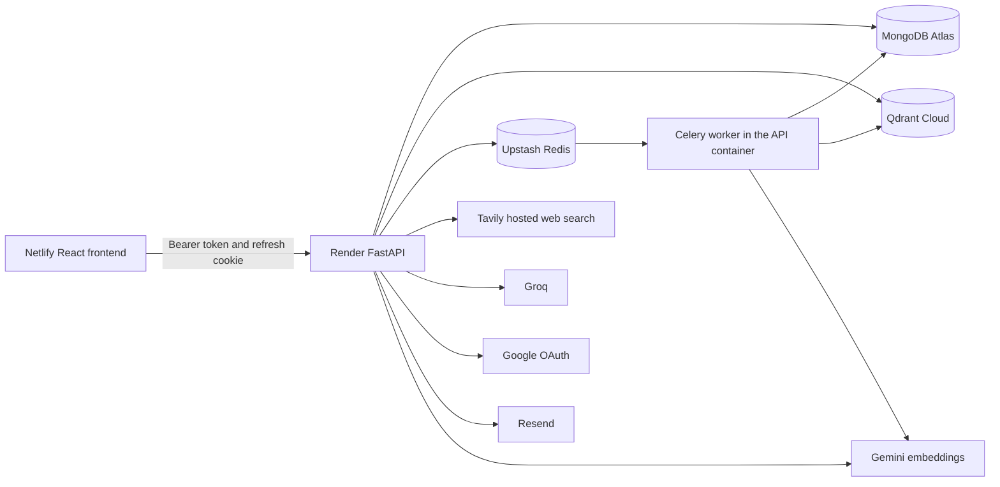

# AskLaw

AskLaw is a deployed legal research and agreement-review workspace. Users can research their own uploaded PDFs, search web sources through Tavily, and inspect streamed answers alongside source and claim-verification information. **Before You Sign** adds source-linked rental-agreement key-term review, two-version text comparison, and downloadable reports. The application uses a React frontend, a FastAPI backend, MongoDB for accounts and documents, Qdrant for document vectors, and Celery for background indexing.

AskLaw provides educational and informational research assistance, not legal advice. Retrieved sources and the claim verifier help users inspect an answer; they do not establish that an answer is legally correct.

## Contents

- [Live demo and deployment](#live-demo-and-deployment)
- [What AskLaw does](#what-asklaw-does)
- [Before You Sign](#before-you-sign)
- [Tavily web search](#tavily-web-search)
- [Architecture](#architecture)
- [Research pipeline](#research-pipeline)
- [Document lifecycle](#document-lifecycle)
- [Technology stack](#technology-stack)
- [Project structure](#project-structure)
- [Local setup](#local-setup)
- [Environment variables](#environment-variables)
- [API overview](#api-overview)
- [Document-scoped research](#document-scoped-research)
- [Verification](#verification)
- [Testing and evaluation](#testing-and-evaluation)
- [Security and limitations](#security-and-limitations)
- [Deployment notes](#deployment-notes)

## Live demo and deployment

| Part | Current deployment | Role |
| --- | --- | --- |
| Frontend | [askklaw.netlify.app](https://askklaw.netlify.app/) on Netlify | Vite-built React single-page application; `frontend/public/_redirects` supports direct route loads |
| API and indexing worker | [asklaw-api.onrender.com](https://asklaw-api.onrender.com/health) on one Render Free Web Service | FastAPI and one Celery worker run in the same backend container |
| Active web search | Tavily hosted search API | Server-side web retrieval; the API key stays in the backend |
| Accounts, documents, conversations | MongoDB Atlas | Persistent MongoDB records |
| Document vectors | Qdrant Cloud | The Gemini collection is `asklaw_documents_gemini` |
| Task queue and results | Upstash Redis | TLS `rediss://` connections for Celery's broker and result backend |
| Embeddings | Gemini Embedding 2 | Batched, 3072-dimensional document and query embeddings |
| Answer generation | Groq | Streamed chat completions |
| Authentication email | Resend | Email verification and password-reset codes |
| Google sign-in | Google OAuth | Verified Google identity, linked to an AskLaw account |

### Current release status - 18 October 2026

The maintainer confirmed successful deployment of Tavily and Before You Sign from **`codex/guest-demo-experience`**, including commit **`492fac9`** (focused review excerpts). This README describes that deployed application. **This update to `main` is documentation-only: the latest application code has not been merged into `main` or `deployment`.** For the deployed implementation, use the [guest-demo branch](https://github.com/akhhilreddy/AskLaw/tree/codex/guest-demo-experience).

SearXNG remains an optional configured provider and has deployment files in the repository; it is no longer the active Tavily search path. The documentation update did not independently recheck the live endpoints. Production credentials belong in hosting settings or untracked local environment files, not in Git.

## What AskLaw does

### Authentication and sessions

- Email/password signup sends a six-digit verification code through Resend. A pending account must verify its email before password sign-in.
- Forgot-password and reset-password use single-use, expiring email codes. A password reset increments the account's authentication version, invalidating older versioned tokens.
- Google OAuth verifies Google's ID token and links or creates a user using a verified email. The frontend receives an AskLaw session after exchanging a short-lived, one-time code.
- Signed-in users can register, list, and remove passkeys on the protected `/security` page. Registration requests a platform authenticator with a discoverable credential and user verification. Supported Mac and iPhone browsers can use Touch ID or Face ID; the browser and operating system control the biometric prompt.
- Password, Google, and passkey sign-in all issue the same AskLaw access token and HttpOnly refresh cookie. The access token is held in browser `localStorage`; the refresh cookie uses the `/auth` path, `SameSite=None` in production with `Secure`, and `SameSite=Lax` for local development.
- The frontend restores protected sessions with `/auth/me` and performs one shared refresh attempt after an authenticated request receives `401`.
- Passkeys are bound to their WebAuthn relying-party domain. A passkey registered for `localhost` does not sign in to `askklaw.netlify.app`; users register a production passkey separately.
- **Continue as guest** creates a temporary demo account: five chat questions within a one-hour session, web research only. Guests cannot upload PDFs or review private agreements, but can try the clearly labelled synthetic Before You Sign sample.
- A slow first API health check shows a server-waking message. The interface includes example questions and the disclaimer: "AskLaw provides legal information, not legal advice."

### Document workspace

- A persistent, newest-first library shows only the authenticated user's PDF records.
- Upload validates a PDF filename and MIME type, then extracts text and page-aware chunks in the API request. Celery embeds those chunks and indexes them in Qdrant in the background.
- The Documents page shows `uploaded`, `processing`, `indexed`, and `failed` states, polls while indexing is in progress, and offers Research when a document is ready.
- Users can delete an owned document after processing finishes. The backend removes its Qdrant points before removing its MongoDB record.
- Default upload limits are 5 MiB and 50 pages. New supported uploads also retain complete extracted page text for agreement review; existing research chunks and background indexing remain in use.

### Research chat

- Conversations and message history are stored in MongoDB and scoped to the authenticated user.
- The deterministic query router chooses conversational, document RAG, web, or hybrid research. A clearly casual greeting bypasses retrieval and has no sources or grounding score.
- A general question can use web search without an uploaded document. An unscoped RAG query with no document results falls back to web retrieval; a selected document remains scoped to that document.
- The chat streams answer tokens and then backend-created source, route, and verification metadata. Document sources and web sources are displayed separately, including hybrid answers.
- The frontend shows claim support (`supported`, `partial`, or `unsupported`) and a grounding score when research verification data is returned.
- Dependency outages are distinct from successful searches with no results. A web outage produces a structured availability notice; HYBRID can continue with available document evidence, and a document-retrieval failure does not discard successful web evidence.

## Before You Sign

This separate protected workspace at `/agreements` starts with **English, selectable-text rental agreements**. It does not make a legal enforceability decision or label a contract safe to sign.

| Tool | What it does | What it does not claim |
| --- | --- | --- |
| Find key terms | Finds candidate passages mentioning deposit, rent/payment, notice, lock-in, termination, renewal, deductions/charges and disputes/jurisdiction | An unidentified term is not necessarily absent; mentions are not a legal risk score |
| Compare versions | Shows added, removed, changed and whitespace-only passage groups, including literal amount/period observations | Not semantic one-to-one clause matching, signature verification or a calculation of money owed |
| Download report | Exports escaped, self-contained HTML with source passages, references, extracted-text hashes, limitations and disclaimer; use browser Print to save as PDF | No built-in PDF/DOCX generation, legal certification or separate saved report history |

### Focused excerpts and traceability

Review analysis **version 2** prefers numbered or named sections instead of repeating entire pages under every heading. Unstructured text uses matching sentences with nearby qualifying context. The UI/export labels **Clause candidate**, **Local context excerpt**, and **Clipped excerpt**; excerpts are bounded at 2,000 characters. A clause about both termination and notice may legitimately appear under both categories. These are deterministic structural/keyword heuristics, not guaranteed semantic clause extraction.

Every quotation retains document ID, page number, exact Unicode code-point offsets (zero-based, end-exclusive), and a page-text SHA-256. Hashes identify extracted text, not original PDF bytes or signature authenticity. The agreement tools do not call Groq, Gemini or Tavily to generate their findings. Their already-indexed input documents still use the normal upload/indexing pipeline.

### Use the feature

1. Sign in with a registered account and upload the original and revised PDFs separately in **Documents**.
2. Wait for both documents to become **Indexed**.
3. Open **Before You Sign**, refresh the library, select original/revised versions and choose **Compare exact text**.
4. Use **Find key terms** for a single agreement, inspect source references, then download a report.
5. Alternatively, use **Try sample**, including as a guest. It is fictional, not a usable legal template.

The tested rental example changes the deposit from **INR 10,000 to INR 15,000** on page 1 and notice from **30 to 90 days** on page 2. Both changes are displayed with source passages, without declaring either term illegal. The version-2 export was checked against the PDFs for quotation, offset and hash consistency.

Agreement review is bounded to **50 pages and 100,000 extracted characters**, requires readable text on every page, and independently checks ownership of both comparison inputs. Legacy uploads without preserved page text must be re-uploaded for this feature; current page-text uploads need only a new review to obtain version-2 excerpts. Previously downloaded reports are not automatically rewritten. OCR, state-specific validity analysis and financial/deadline calculations are not implemented.

See the [agreement implementation and limitations](https://github.com/akhhilreddy/AskLaw/blob/codex/guest-demo-experience/AGREEMENTS.md) on the deployed source branch.

## Tavily web search

The deployed backend uses `WEB_SEARCH_PROVIDER=tavily`. Tavily replaces the web-search transport only: document RAG, query routing, evidence ranking, Groq streaming and claim verification remain separate parts of the existing pipeline.

- `TAVILY_API_KEY` is backend-only. Never put it in a frontend file, a `VITE_` variable, logs or a committed `.env`.
- Ordinary web retrieval uses one search; expanded retrieval is capped by `TAVILY_MAX_QUERIES` (default 2, configurable as 1 or 2).
- Calls explicitly use basic search, disable automatic parameter selection, and do not request a provider-generated answer or raw page content. AskLaw still ranks returned source material and generates its own response through Groq.
- The adapter has a 12-second default operation timeout (maximum 30), a connect timeout capped at 5 seconds, and the shared retrieval deadline. It does not automatically retry Tavily POST requests or switch to SearXNG after a Tavily failure.
- Missing configuration, timeouts, quota/rate limits, HTTP failures and invalid responses produce the structured web-unavailable state, not a false "no evidence" result. Successful empty searches remain distinct from outages.
- Tavily bypasses the separate SearXNG readiness/wake-up wait. **The FastAPI service itself can still cold-start on Render Free.** Provider credit limits and availability still apply; AskLaw does not maintain a monthly credit ledger.
- `WEB_SEARCH_PROVIDER=searxng` remains supported explicitly; the repository default is still SearXNG. Keeping that option does not mean Tavily falls back to it automatically.

See [web-search configuration and failure behavior](https://github.com/akhhilreddy/AskLaw/blob/codex/guest-demo-experience/deploy/web-search.md) on the deployed source branch. No Tavily key or provider change is needed in Netlify.

## Architecture



The Render backend image runs `backend/docker/start.sh`: one Celery worker (`solo`, concurrency 1) and one Uvicorn worker bound to `0.0.0.0:$PORT`. This is the project's Render Free demo arrangement; there is no paid Background Worker service. If either child process exits, the script stops the other so Render can restart the container.

The web retrieval path imports AskLaw's `search_web` MCP tool function directly into the API process; provider selection dispatches to Tavily in the deployed configuration or to SearXNG when explicitly selected. Local development also starts a standalone MCP server, but the public Render command does not start a separate MCP process. Before You Sign uses owner-scoped MongoDB page text and deterministic analysis alongside, not inside, the research chat. The `compose.production.yml` stack is a separate container-based deployment option in the repository, not the current Netlify/Render deployment.

## Research pipeline


The router recognizes legal provision and document wording, current-event wording, general questions, and a narrow set of complete casual utterances. Web research can expand a recent legal question into targeted searches and rank the results. The backend creates source metadata from retrieved material rather than accepting generated citations as the source list. With no usable evidence, the answer path is constrained to acknowledge that limitation.

## Document lifecycle

1. `POST /documents/upload` receives a multipart `file` field from an authenticated user. It checks the PDF filename, `application/pdf` MIME type, upload size, page count, and extracted-text size.
2. `pypdf` extracts selectable text page by page. AskLaw stores the text, page-aware chunks, metadata, owner ID, and initial `uploaded` status in the existing MongoDB `documents` collection. Eligible new uploads also store complete page text and agreement-analysis eligibility/version metadata. It does not keep the original PDF binary.
3. The API submits an indexing task to Celery through Redis. The worker claims the record, sets `processing`, batches embeddings, and writes vectors with `user_id`, `document_id`, filename, page number, and chunk index in the Qdrant payload.
4. The worker marks the record `indexed` on success or `failed` after an unrecoverable error or exhausted retries. The Documents page refreshes its list while an upload is pending.
5. Research requires an indexed, owned document. Deletion is blocked while a record is `uploaded` or `processing`.

Indexing uses processing leases, bounded retries, sanitized persisted failure codes and stale-processing recovery. Terminal failure cleans up inserted vectors; retrieval uses indexed documents only. If Redis does not confirm task submission, the upload path reports an actionable error rather than silently leaving a successful-looking queued upload.

Chunks are 1,000 characters with 150 characters of overlap. The local MiniLM option produces 384-dimensional vectors in its own collection. The Gemini option uses `gemini-embedding-2`, 3072 dimensions, a separate `asklaw_documents_gemini` collection, and a configurable batch size (default 32). AskLaw validates an existing collection's vector size rather than changing it. The Gemini Docker image omits PyTorch, Sentence Transformers, and the local model weights.

## Technology stack

| Layer | Implementation |
| --- | --- |
| Frontend | React 19, React Router 7, Vite 8, Axios, React Markdown, Tailwind CSS 4 |
| API | FastAPI, Pydantic, Uvicorn, Python 3.12 production image |
| Persistence | PyMongo and MongoDB Atlas in the public deployment |
| Vector search | Qdrant client and Qdrant Cloud in the public deployment |
| Embeddings | Gemini Embedding 2 in production; optional local MiniLM provider |
| Background work | Celery with Redis broker and result backend |
| Web search | Tavily hosted API through AskLaw's provider adapter/MCP tool function; optional SearXNG provider |
| Agreement review | Deterministic section/sentence excerpt selection, exact source coordinates/hashes and bounded passage-group comparison |
| Generation | Groq API |
| Authentication | bcrypt, JWT access/refresh tokens, Google OAuth, email OTP, WebAuthn passkeys |
| PDF extraction | `pypdf` |
| Hosting | Netlify frontend, Render API/Celery, Tavily hosted search and external managed data services; optional separate SearXNG service |

## Project structure

```text
AskLaw/
├── backend/
│   ├── app/api/                 # Auth, document, agreement, conversation, chat, health routes
│   ├── app/core/                # Settings, dependencies, Celery
│   ├── app/db/                  # MongoDB collections and indexes
│   ├── app/mcp/                 # Search tool with provider dispatch
│   ├── app/services/            # Tavily, agreements, auth, document, retrieval, verification
│   ├── app/tasks/               # Background document indexing
│   ├── docker/start.sh          # Combined Render API/Celery startup
│   ├── evaluation/              # Offline and live evaluation harness
│   ├── tests/                   # Backend tests
│   ├── Dockerfile
│   └── requirements-gemini.txt  # Smaller Gemini production dependency set
├── frontend/
│   ├── public/_redirects        # Netlify SPA route fallback
│   ├── src/pages/               # Landing, auth, dashboard, documents, agreements, security
│   ├── src/components/          # Workspace, chat, and auth UI
│   ├── src/hooks/               # Streaming chat and conversation state
│   ├── src/services/            # API, auth, chat, passkey clients
│   ├── tests/                   # Frontend tests
│   └── vercel.json              # Alternative Vercel SPA rewrite
├── deploy/searxng/              # Optional SearXNG image and settings
├── AGREEMENTS.md                # Agreement feature notes on the deployed source branch
├── compose.production.yml       # Alternative self-hosted production stack
├── docker-compose.yml           # Local MongoDB, Qdrant, Redis, SearXNG
├── start.sh                      # Starts the local application stack
└── stop.sh                       # Stops the local application stack
```

## Local setup

You need Python, Node.js/npm, Docker Compose, and credentials for the features you want to exercise. The production Dockerfile uses Python 3.12; the frontend Dockerfile builds with Node 22. MongoDB, Qdrant, Redis, and SearXNG can run locally through the root Compose file.

```bash
git clone https://github.com/akhhilreddy/AskLaw.git
cd AskLaw
git switch codex/guest-demo-experience
cd backend
python3 -m venv .venv
source .venv/bin/activate
python -m pip install -r requirements.txt
cp .env.example .env
cd ../frontend
npm ci
cp .env.example .env
cd ..
```

Before startup, edit `backend/.env`. Set a non-default `SECRET_KEY` and a `GROQ_API_KEY` for generated answers. To use the deployed search provider locally, set `WEB_SEARCH_PROVIDER=tavily` and your backend-only `TAVILY_API_KEY`. The checked-in backend example selects Gemini embeddings but leaves `GEMINI_API_KEY` empty; supply that key or switch to `EMBEDDING_PROVIDER=local` with a 384-dimensional local collection. Email signup and password reset require `RESEND_API_KEY` and a verified `EMAIL_FROM` sender. Google sign-in requires its client ID, secret, and callback URI. Passkeys use the local frontend origin and RP ID derived from `FRONTEND_URL` unless explicitly overridden. Keep all credentials in untracked environment files or hosting settings.

Then start the local stack:

```bash
./start.sh
```

Open `http://localhost:5173`; the API docs are at `http://localhost:8000/docs`. The local script starts Docker services, FastAPI, Celery, a local MCP server, and Vite. Stop it with `Ctrl+C` or `./stop.sh`. The root Compose file uses named data volumes by default; optional `ASKLAW_MONGODB_DATA` and `ASKLAW_QDRANT_DATA` overrides retain existing bind-mounted data.

## Environment variables

The backend settings are defined in [`backend/app/core/config.py`](backend/app/core/config.py). The checked-in [`backend/.env.example`](backend/.env.example) is for local development; [`deploy/production.env.example`](deploy/production.env.example) is a secret-free example for the alternative Compose stack. The public Render service uses its own environment settings.

| Group | Backend variables | Purpose |
| --- | --- | --- |
| App and sessions | `APP_ENV`, `SECRET_KEY`, `ALGORITHM`, `ACCESS_TOKEN_EXPIRE_MINUTES`, `REFRESH_TOKEN_EXPIRE_DAYS`, `COOKIE_SECURE`, `ALLOW_LEGACY_UNTYPED_REFRESH_TOKENS` | JWT/session settings and production checks |
| Browser origins | `FRONTEND_URL`, `CORS_ORIGINS` | Frontend redirects and allowed credentialed requests |
| Email codes | `RESEND_API_KEY`, `EMAIL_FROM`, `EMAIL_OTP_SECRET`, `EMAIL_OTP_EXPIRE_MINUTES`, `EMAIL_OTP_MAX_ATTEMPTS`, `EMAIL_OTP_RESEND_COOLDOWN_SECONDS` | Verification and password reset |
| Google OAuth | `GOOGLE_CLIENT_ID`, `GOOGLE_CLIENT_SECRET`, `GOOGLE_REDIRECT_URI`, `GOOGLE_OAUTH_STATE_EXPIRE_MINUTES`, `GOOGLE_OAUTH_EXCHANGE_EXPIRE_MINUTES` | Google sign-in and one-time frontend exchange |
| Passkeys | `WEBAUTHN_RP_ID`, `WEBAUTHN_RP_NAME`, `WEBAUTHN_ORIGIN`, `WEBAUTHN_CHALLENGE_EXPIRE_MINUTES` | WebAuthn domain, display name, and challenge lifetime |
| MongoDB | `MONGODB_URL`, `MONGODB_DATABASE` | Users, auth records, documents, conversations |
| Qdrant | `QDRANT_URL`, `QDRANT_API_KEY`, `QDRANT_COLLECTION_NAME` | Vector collection and hosted Qdrant authentication |
| Embeddings | `EMBEDDING_PROVIDER`, `EMBEDDING_MODEL`, `GEMINI_API_KEY`, `GEMINI_EMBEDDING_BATCH_SIZE` | Local or Gemini provider and batch size |
| Chat | `GROQ_API_KEY` | Answer generation |
| Celery | `CELERY_BROKER_URL`, `CELERY_RESULT_BACKEND` | Redis broker and result backend; TLS is configured for `rediss://` URLs |
| Web search provider | `WEB_SEARCH_PROVIDER`, `TAVILY_API_KEY`, `TAVILY_MAX_QUERIES`, `TAVILY_TIMEOUT_SECONDS` | Tavily selection, backend credential and bounded requests |
| Optional SearXNG | `SEARXNG_URL` | Full JSON endpoint including `/search`, only used with the SearXNG provider |
| Research deadlines | `RESEARCH_DEADLINE_SECONDS`, `SEARXNG_READINESS_BUDGET_SECONDS`, `SEARXNG_IDLE_REPROBE_SECONDS` | Overall retrieval cap and optional SearXNG readiness settings; see deployed settings for exact names/defaults |
| Proxy trust | `TRUSTED_PROXY_HOPS` | Right-most-Nth forwarded-address selection; measured Render value 3, safe direct-peer default 0 |
| Local MCP server | `MCP_HOST`, `MCP_PORT` | Standalone local MCP listener |
| Upload limits | `MAX_DOCUMENT_UPLOAD_BYTES`, `MAX_DOCUMENT_PAGES`, `MAX_DOCUMENT_TEXT_BYTES` | PDF request and extraction caps |

The Netlify build needs `VITE_API_BASE_URL=https://asklaw-api.onrender.com`. This Vite variable is embedded at build time. In Render, the frontend origin is `https://askklaw.netlify.app`, the Google callback is `https://asklaw-api.onrender.com/auth/google/callback`, `WEBAUTHN_ORIGIN` is `https://askklaw.netlify.app`, and `WEBAUTHN_RP_ID` is `askklaw.netlify.app`. The API service holds `WEB_SEARCH_PROVIDER=tavily` and the private `TAVILY_API_KEY`. `APP_ENV=production` also requires HTTPS WebAuthn origin, a secure cookie, explicit CORS origins, configured Resend sender/key, and a non-default secret of at least 32 characters. Qdrant Cloud requires `QDRANT_API_KEY` in production. Before You Sign requires no new key, environment variable or database collection.

If deliberately using SearXNG instead, configure its separate service with `SEARXNG_SECRET`, `SEARXNG_BASE_URL`, `SEARXNG_PORT=10000`, and `SEARXNG_BIND_ADDRESS=0.0.0.0`; the API uses `SEARXNG_URL=https://asklaw-searxng.onrender.com/search`. See [`deploy/searxng/README.md`](deploy/searxng/README.md). Do not place secret values in this README or Git.

## API overview

| Route | Access | Purpose |
| --- | --- | --- |
| `GET /health` | Public | API health |
| `GET /auth/providers` | Public | Advertise configured Google and passkey options |
| `POST /auth/guest` | Public, creation rate-limited | Create a temporary guest demo session |
| `POST /auth/signup`, `/auth/verify-email`, `/auth/resend-verification` | Public | Email account and verification flow |
| `POST /auth/forgot-password`, `/auth/reset-password` | Public | Email-code password recovery |
| `POST /auth/login`, `/auth/token`, `/auth/refresh`, `/auth/logout` | Login or refresh flow | AskLaw access token and refresh cookie |
| `GET /auth/google/start`, `/auth/google/callback`; `POST /auth/google/exchange` | Google OAuth flow | Verified Google account and AskLaw session |
| `POST /auth/passkeys/register/options`, `/auth/passkeys/register/verify` | Bearer access token | Register a passkey on the signed-in account |
| `POST /auth/passkeys/authenticate/options`, `/auth/passkeys/authenticate/verify` | Public | Sign in with a registered passkey |
| `GET /auth/passkeys`, `DELETE /auth/passkeys/{credential_id}` | Bearer access token | List or remove owned passkeys |
| `GET /auth/me` | Bearer access token | Current user profile |
| `GET /documents` | Bearer access token | Newest-first list of owned documents |
| `POST /documents/upload` | Registered account, rate-limited | Multipart PDF `file` upload and indexing task |
| `DELETE /documents/{document_id}` | Bearer access token | Remove an owned document and its vectors |
| `/conversations/` and `/conversations/{conversation_id}` | Bearer access token | Create, list, read, rename, and delete owned conversations |
| `POST /chat/stream` | Bearer access token | NDJSON answer, sources, route, and verification events |
| `GET /agreements/documents` | Registered account | Latest 100 owned uploads with agreement-review availability |
| `POST /agreements/review` | Registered account, shared chat limits | Source-linked key-term candidates for one document ID |
| `POST /agreements/compare` | Registered account, shared chat limits | Independently owner-checked original/revised document IDs |
| `GET /agreements/demo` | Signed-in account or guest, shared chat limits | Synthetic review/comparison; no private document read |

The backend derives the user ID from the validated token. It never treats a client-supplied `user_id` as proof of ownership.

## Document-scoped research

Clicking **Research** on an indexed document opens `/dashboard?document_id=<id>`. The selected ID survives refresh, and the chat request carries it to `/chat/stream`. The API first checks that the document belongs to the signed-in user and is indexed. Qdrant document retrieval filters by both `user_id` and `document_id`; unscoped document retrieval still filters by `user_id`. Missing and unowned documents are both reported as not found.

A selected document limits the document side of RAG or hybrid retrieval. A web-only question can still use web sources. Normal chat without a selected document retains its usual conversation and retrieval behavior.

## Verification

For research answers, the backend compares generated claims with the retrieved evidence and reports `supported`, `partial`, or `unsupported` results plus a grounding score. The chat displays document pages, web URLs, source grouping, and the verification summary when present. Casual conversation has no retrieval sources or verification block. A research answer with no returned sources displays that absence rather than inventing evidence.

Verification measures support in retrieved material. It is a deterministic check, not a legal correctness guarantee or a substitute for reviewing the cited material.

## Testing and evaluation

From the repository root, use the existing isolated tests and build checks:

```bash
cd backend
.venv/bin/python -m compileall -q app tests evaluation
WEB_SEARCH_PROVIDER=searxng .venv/bin/python -m unittest discover -s tests -p 'test_*.py'
cd ../frontend
node --test tests/*.test.js
npm run lint
npm run build
cd ..
git diff --check
```

The process-only `WEB_SEARCH_PROVIDER=searxng` test selection above preserves the legacy SearXNG test baseline; Tavily tests explicitly exercise their adapter. It does not edit `.env` or change the deployed provider. Run these checks from the deployed source branch for the latest feature suites.

At commit `492fac9`, **256 backend tests and 23 frontend tests passed**, with lint and production build passing. Coverage includes guest restrictions, shared Redis limits/fail-open handling, document lifecycle, retrieval degradation, Tavily transport, ownership of both comparison inputs, exact quote/page/hash consistency, focused excerpts and escaped report export. Real in-memory PDF extraction is tested with database/queue operations mocked. Local user acceptance also confirmed uploads, comparison and the exported focused key-term report. These results are not a guarantee of every legal document or production dependency.

[`backend/tests/README.md`](backend/tests/README.md) describes a live, two-account workflow. [`backend/evaluation/README.md`](backend/evaluation/README.md) explains the offline and live retrieval evaluation harness. Run the offline harness with:

```bash
cd backend
.venv/bin/python evaluation/run_evaluation.py
```

Public endpoint checks:

```bash
curl --fail --show-error https://asklaw-api.onrender.com/health
curl --fail --show-error https://asklaw-api.onrender.com/auth/providers
```

Render Free services may take time to wake after inactivity. An authenticated smoke test should also cover guest web research, registered-account sign-in, a small text-based PDF moving to `indexed`, document Research, Tavily-backed web research, agreement comparison, focused key-term review, report download and deletion. A healthy API response does not independently verify Tavily credentials, quota, result quality or all other dependencies.

## Security and limitations

- Access and refresh JWTs have distinct purposes. Protected routes require an access token; refresh uses an HttpOnly cookie. Production sets `COOKIE_SECURE=true`, uses explicit CORS origins, and checks browser origins on cookie-sensitive authentication endpoints.
- MongoDB document, conversation, and passkey records are scoped to the authenticated user. Qdrant retrieval and deletion include an owner filter.
- Email codes, Google exchange codes, and passkey challenges are short-lived and single-use. WebAuthn verifies the origin, relying-party ID, challenge, and user verification.
- PDF uploads have filename, MIME, size, page, and extracted-text checks. Image-only/scanned PDFs are not searchable because OCR is not implemented.
- The browser access token is stored in `localStorage`. Refresh tokens are not rotated or individually revoked server-side; logout clears the browser cookie. Password reset invalidates versioned tokens by incrementing `auth_version`.
- Shared Redis limits cover login (5 attempts/5 minutes per email, 20/minute per IP), signup (10/hour per IP, 3/hour per email), guest creation (10/hour per IP), chat (10/minute and 100/day per user, maximum 2 concurrent), and uploads (5/hour per user, maximum 1 concurrent). Agreement analysis/sample operations share chat limits. Counters expire automatically; Redis unavailability fails open with a sanitized warning. Limits return `429` and `Retry-After`.
- Client IP selection uses a trusted proxy hop count and the Nth forwarded address from the right, not an attacker-controlled leftmost value; malformed/missing headers fall back to the direct peer. The measured Render hop count was 3; temporary proxy diagnostics were removed.
- The claim verifier cannot prove legal correctness. Tavily result text/metadata is evidence input, not a comprehensive read of every destination or a guarantee of source authority/currentness.
- Before You Sign is bounded document-text analysis, not legal advice, a state-specific contract-validity opinion or a substitute for professional review. It does not compare signatures, stamps, images or original PDF layout.
- PDF extraction and chunking happen during the upload request. Large files, Gemini free-tier quotas, upstream search availability, and Render Free resource/sleep limits can affect the demo. The combined API/Celery process is a small-demo deployment arrangement, not a scaling design.

## Deployment notes

- Netlify builds `frontend/` with `npm run build` and serves `frontend/dist`. `frontend/public/_redirects` maps SPA routes to `index.html`. The checked-in `frontend/vercel.json` is an alternative rewrite for Vercel and is not the current host.
- Render builds `backend/Dockerfile` in Gemini mode and starts its default `backend/docker/start.sh`. The API binds `$PORT`; Celery uses one `solo` worker in the same container. `GET /health` is the API health endpoint.
- The active web provider is Tavily, configured only on the API service. The optional SearXNG Docker service builds `deploy/searxng/Dockerfile`, listens on port `10000`, and exposes `/search` and `/healthz`; it is not required for Tavily requests.
- The maintainer's current deployed source is `codex/guest-demo-experience` at `492fac9`. Both backend and frontend need that feature release for the agreement API/UI and focused exports. This README commit alone does not merge or redeploy application code.
- MongoDB Atlas, Qdrant Cloud, and Upstash Redis are external to Render. The backend uses authenticated Qdrant requests and verified TLS for `rediss://` broker and result-backend URLs.
- The root `compose.production.yml` and [`deploy/README.md`](deploy/README.md) describe an alternative self-hosted stack. They are not the infrastructure currently serving the public demo.
- Netlify and Render deployment settings and third-party dashboards hold production values. The repository contains examples and code, not production secrets or a restorable cloud deployment snapshot.
